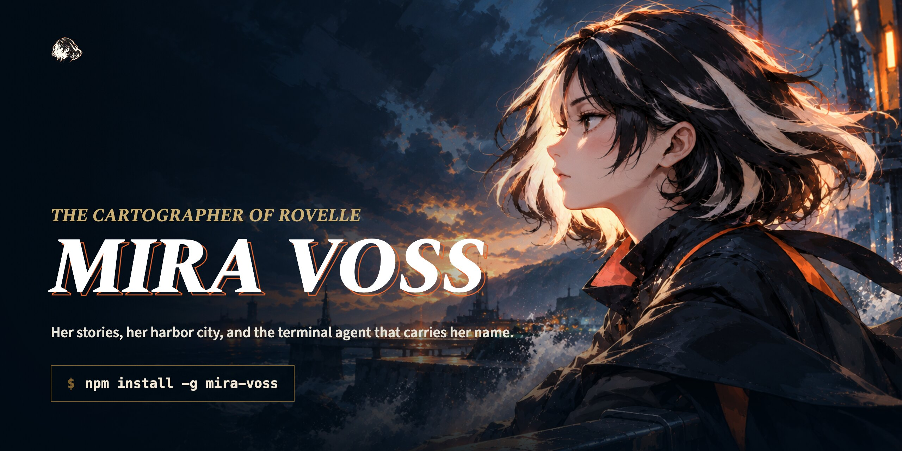
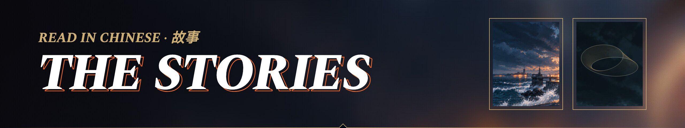
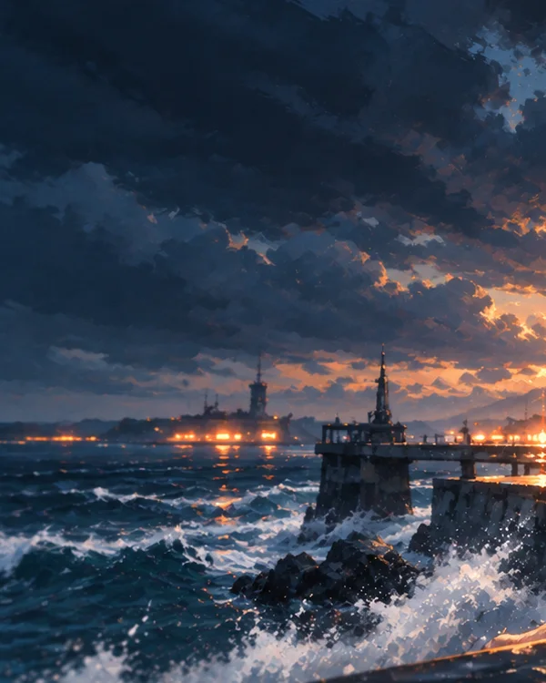
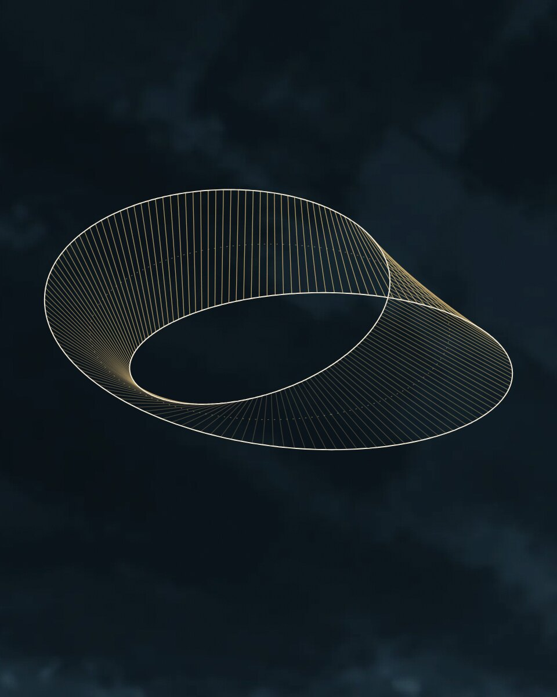
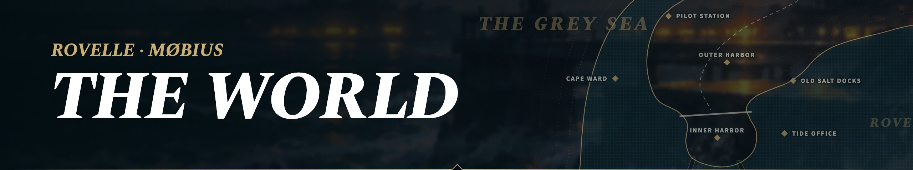
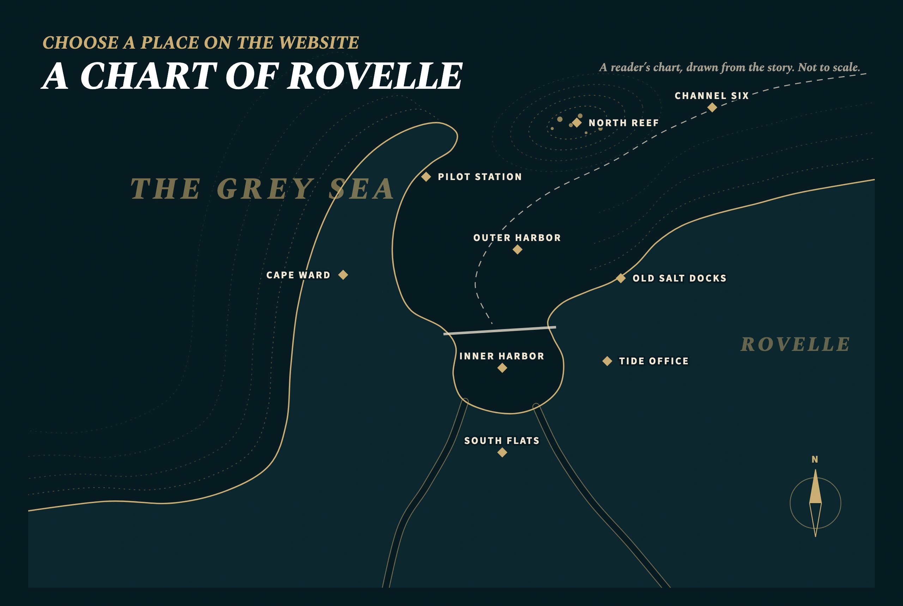
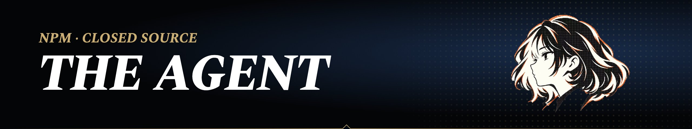

<p align="center">
  <a href="https://mangiapanejohn-dev.github.io/mira-voss/"></a>
</p>

<p align="center">
  <a href="https://mangiapanejohn-dev.github.io/mira-voss/"><b>Website</b></a>&nbsp;&nbsp;·&nbsp;&nbsp;<a href="https://mangiapanejohn-dev.github.io/mira-voss/stories.html"><b>Read the stories</b></a>&nbsp;&nbsp;·&nbsp;&nbsp;<a href="https://mangiapanejohn-dev.github.io/mira-voss/world.html"><b>Rovelle</b></a>&nbsp;&nbsp;·&nbsp;&nbsp;<a href="#install"><b>Install</b></a>&nbsp;&nbsp;·&nbsp;&nbsp;<a href="https://www.npmjs.com/package/mira-voss"><b>npm</b></a>
</p>

<p align="center">
  <a href="https://www.npmjs.com/package/mira-voss"></a>
  
  
  <a href="https://mangiapanejohn-dev.github.io/mira-voss/stories.html"></a>
</p>

<br />

<p align="center"><i>有些地方，只能等人到了以后，再慢慢画出来。</i><br /><sub>Some places can only be charted after someone arrives. — <i>The Unfinished Chart</i>, Chapter VII</sub></p>

<br />

Mira Voss is seventeen, a tidal researcher from **Rovelle**, a harbor city that trusts its charts a little too early. She can read the deep sea from scraps of evidence; letting anyone else into the work is taking her longer. Her story is written in Chinese, translated into English, and published here in full in both.

She is also the name and face of **Mira Voss**, a closed-source terminal agent distributed on npm. This repository is her public home: the stories, the world, the art and the documentation. It does not contain the agent's runtime.

<a id="install"></a>

## Install

```bash
npm install -g mira-voss
```

Then run `mira` (or `mobius`) in the folder you want to work in and follow the sign-in prompts. Node.js 22 or newer is recommended. Updates, platform notes and troubleshooting are in the [installation guide](docs/install.md); the [quickstart](docs/quickstart.md) walks through a first session.

<br />

<a href="https://mangiapanejohn-dev.github.io/mira-voss/stories.html"></a>

| | |
| :-- | :-- |
| <a href="https://mangiapanejohn-dev.github.io/mira-voss/read.html?work=unfinished-chart"></a> | **The Unfinished Chart** · 《罗维尔：未完成的海图》<br /><sub>ROVELLE · BOOK ONE · PROLOGUE + 7 CHAPTERS · v3.0</sub><br /><br />A winter current is coming, and the city wants to use Mira's tidal chart beyond the conditions it was tested in. To correct the record she has to make its limits public, and let other people into a decision that cannot be hers alone.<br /><br />[Read online](https://mangiapanejohn-dev.github.io/mira-voss/read.html?work=unfinished-chart) · [Chinese text](lore/zh/README.md) · [Character profile](lore/zh/character-profile.md) |
| <a href="https://mangiapanejohn-dev.github.io/mira-voss/read.html?work=only-one-side"></a> | **Only One Side** · 《MØBIUS：只有一面》<br /><sub>MØBIUS · SHORT STORY · 4 PARTS · v1.0 · NEW</sub><br /><br />Three days north of Ailan, a station without a name keeps its deep-water record on a paper loop twisted half a turn. For nineteen winters, part of the sea in it was written off as ink bleeding through the paper.<br /><br />[Read online](https://mangiapanejohn-dev.github.io/mira-voss/read.html?work=only-one-side) · [Chinese text](lore/zh/only-one-side/README.md) |

New stories are added to [`lore/catalog.json`](lore/catalog.json). The website's library and reader are built from it by [`scripts/build-stories.mjs`](scripts/build-stories.mjs).

<br />

<a href="https://mangiapanejohn-dev.github.io/mira-voss/world.html"></a>

Rovelle is built between a headland and two rivers, facing the Grey Sea. It records its tides, checks its instruments, and rings three bells when the water turns: the first warns, the second restricts the channels, the third closes them. Three days north of Ailan, on a cape beside Vard Light, stands the research station that came to be called **MØBIUS**.

<a href="https://mangiapanejohn-dev.github.io/mira-voss/world.html"></a>

[Rovelle](lore/rovelle.md) · [MØBIUS Station](lore/mobius-station.md) · [Mira Voss](lore/mira-voss.md) · [Canon and continuity](lore/canon.md)

<br />

<a href="https://mangiapanejohn-dev.github.io/mira-voss/agent.html"></a>

| Key | Ability | |
| :-: | :-- | :-- |
| **P** | Asks before she changes things | In the default mode, she asks for your approval before changing your project. |
| **Q** | Reads the project | Started in a folder, she reads the files there. |
| **W** | Edits files | She makes the edits a task needs directly in your files. |
| **E** | Runs commands | Builds, tests and scripts, and she reads what they print. |
| **R** | Shows her work | She shows you what she has done, so you can check it. |

What the CLI actually does is defined by its code, its model and provider, your configuration and the permissions you set. The stories give Mira a face and a voice; they do not describe the software. See [product vs. fiction](docs/product-vs-fiction.md) and the [FAQ](docs/faq.md).

<br />

## In this repository

| Path | What it holds |
| :-- | :-- |
| [`lore/`](lore/README.md) | The stories in Chinese and in English translation, the world, and the canon notes |
| [`site/`](site/README.md) | The website at [mangiapanejohn-dev.github.io/mira-voss](https://mangiapanejohn-dev.github.io/mira-voss/) |
| [`media/`](media/README.md) | The original logo, the approved art, the scenery and these README images |
| [`docs/`](docs/README.md) | Installation, quickstart, FAQ, product scope |
| [`scripts/`](scripts/build-stories.mjs) | The story build for the website |

Report a problem through the [issue templates](https://github.com/mangiapanejohn-dev/mira-voss/issues/new/choose); security issues go through [private vulnerability reporting](https://github.com/mangiapanejohn-dev/mira-voss/security/advisories/new).

## Rights

**Mira Voss is closed source.** This repository publishes no runtime code and no open-source license. The stories, art and documentation are public to read, not to reuse; see the [notice](NOTICE.md). Mira Voss, Rovelle and MØBIUS Station are fiction.

<p align="center"><sub>© 2026 Mira Voss project. All rights reserved.</sub></p>
