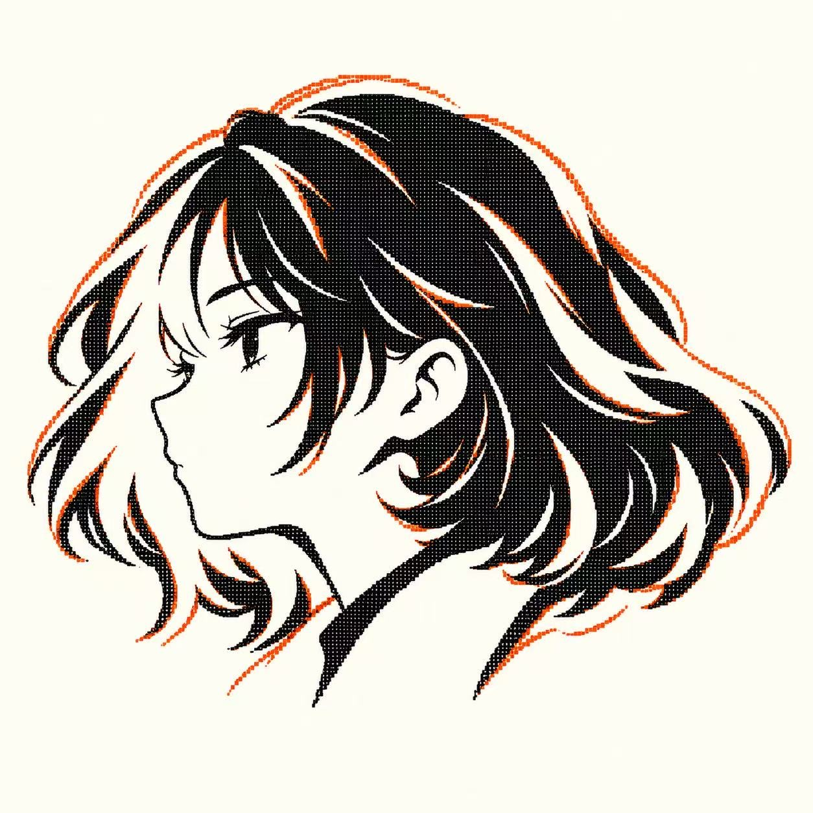

<div align="center">



# Mira Voss

**A presence in the terminal. A story beyond it.**

The official public home for the Mira Voss CLI, its character art, and the world of Rovelle.

[Install](#install) · [The product](#the-product) · [The character](#the-character) · [Read the story](lore/zh/README.md) · [Public website](https://mangiapanejohn-dev.github.io/mira-voss/)

</div>

---

<div align="center">

</div>

## The product

Mira Voss is a proprietary AI agent for work in the terminal. The published CLI can read and edit files, run commands, and report its work in the directory where you start it. Its actual behavior depends on the installed release, selected model, configuration, and permissions. The [npm package](https://www.npmjs.com/package/mira-voss) is the product distribution; this GitHub repository contains its public documentation and creative materials.

## Install

Use Node.js **22 or newer**, as recommended by the published package documentation:

```bash
npm install -g mira-voss
```

Then run `mira` in the directory where you want to work. `mobius` is an alternate executable name. The current published package is **v1.0.0**. See the [installation guide](docs/install.md) for verification, first launch, updates, and platform notes.

## The character

Mira grew up in **Rovelle**, a harbor city where a convincing chart could still leave out a dangerous current. At seventeen, her gift for reading incomplete observations puts her work at the center of a public decision. She must explain where her model stops, listen to the people who will bear the risk, and learn what precision cannot settle between friends and family.

*Rovelle: The Unfinished Chart* closes as she leaves for the northern research station later named **MØBIUS**. The original Chinese novella is preserved here in full: a [prologue and seven chapters](lore/zh/README.md), alongside the [v2.0 character profile](lore/zh/character-profile.md), [canon notes](lore/canon.md), and an [English introduction](lore/the-unfinished-chart.md).

The original [profile logo](media/identity/mira-original-logo.jpg) is the visual identity reference. The [earlier approved key art](media/character/mira-approved-key-art.png) is preserved unchanged from the supplied project archive. The new [Rovelle splash illustration](media/character/mira-rovell-splash-v2.png) places Mira at the harbor while keeping her face and short black-and-white hair recognizable.

## Explore

| Area | What you will find |
| :-- | :-- |
| [Documentation](docs/README.md) | Installation, first launch, FAQs, and product scope |
| [Story and canon](lore/README.md) | Rovelle, Mira, MØBIUS Research Station, and the complete Chinese novella |
| [Visual identity](media/README.md) | Original logo, approved art, and design guidance |
| [Public website](https://mangiapanejohn-dev.github.io/mira-voss/) | A visual introduction to the product and character |
| [Feedback](https://github.com/mangiapanejohn-dev/mira-voss/issues/new/choose) | Bug reports, feature requests, and documentation or lore corrections |

## Rights and scope

**Mira is closed source.** This repository does not publish the CLI runtime, its private source code, or an open-source license. The documentation, story, and images are public to view; public visibility does not grant permission to reuse them. Read the [rights notice](NOTICE.md) and [contribution guide](CONTRIBUTING.md).

Mira's fictional biography gives the product its visual and narrative identity. It does not promise software capabilities, autonomy, or security properties. See [Product vs. Fiction](docs/product-vs-fiction.md).

© 2026 Mira Voss project. All rights reserved.
