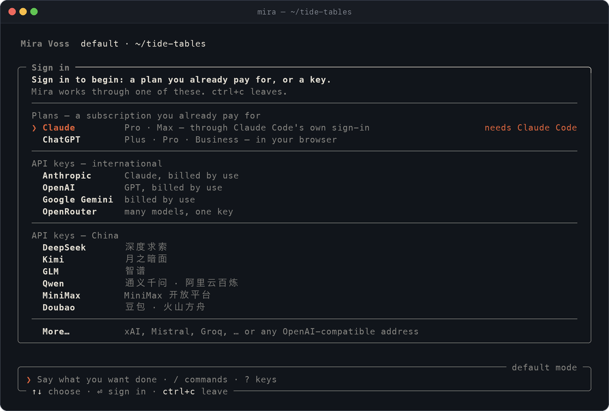

<p align="center">
  <a href="https://mangiapanejohn-dev.github.io/mira-voss/?lang=zh"></a>
</p>

<p align="center">
  <a href="README.md">English</a>&nbsp;&nbsp;·&nbsp;&nbsp;<b>简体中文</b>
</p>

<p align="center">
  <a href="#安装"><b>安装</b></a>&nbsp;&nbsp;·&nbsp;&nbsp;<a href="#登录"><b>登录</b></a>&nbsp;&nbsp;·&nbsp;&nbsp;<a href="#使用"><b>使用</b></a>&nbsp;&nbsp;·&nbsp;&nbsp;<a href="#故事"><b>故事</b></a>&nbsp;&nbsp;·&nbsp;&nbsp;<a href="https://mangiapanejohn-dev.github.io/mira-voss/?lang=zh"><b>网站</b></a>&nbsp;&nbsp;·&nbsp;&nbsp;<a href="https://www.npmjs.com/package/mira-voss"><b>npm</b></a>
</p>

<p align="center">
  <a href="https://www.npmjs.com/package/mira-voss"></a>
  
  
  
</p>

<br />

<p align="center"><b>终端里的 agent。</b>她在你启动她的目录里读项目、改文件、跑命令、汇报结果；默认每次改动前都会先问你。她也是一位来自港城的十七岁制图师，她的故事都在这里。</p>

<p align="center">
  <a href="https://github.com/mangiapanejohn-dev/mira-voss/stargazers"></a>
  <br />
  <sub>如果她对你有用，或者她的故事打动了你，点一颗星，下一个人就更容易找到她。</sub>
</p>

<br />

<p align="center">
  
  <br />
  <sub>1.0.0 第一次启动时的样子。</sub>
</p>

<br />

<a href="https://mangiapanejohn-dev.github.io/mira-voss/agent.html?lang=zh"></a>

<a id="安装"></a>

## 安装

```bash
npm install -g mira-voss
```

然后在要工作的目录里：

```bash
mira
```

输入 `mobius` 也能启动她。需要：

- **Apple 芯片的 macOS**。1.0.0 只为这个系统构建；在其他系统上能装上，但运行时会提示「还不支持这个系统」。
- **Node.js 22 或更新**，以及 npm。
- **一个可用的模型**：你已经付费的 Claude 或 ChatGPT 套餐，或者一个 API 密钥，见[登录](#登录)。

<details>
<summary><b>更新、检查、卸载</b></summary>

```bash
npm install -g mira-voss@latest    # 更新
mira -v                            # 当前版本
mira doctor                        # 逐项检查跑一轮需要的东西
npm uninstall -g mira-voss         # 卸载
```

装完找不到 `mira`，说明 npm 的全局目录不在你的 `PATH` 里。她保存的一切（账号、会话、历史）都在 `~/.mobius` 下。

</details>

<a id="登录"></a>

## 登录

第一次启动时，她会先问你用什么方式连接模型。可以同时登录多个账号，用 `/model` 切换；`mira logout` 或 `/logout` 退出其中一个。

| 套餐或密钥 | 登录方式 | |
| :-- | :-- | :-- |
| **Claude 套餐** <br /><sub>Pro · Max</sub> | 走 Claude Code 自己的登录 | 需要本机已安装 Claude Code 并在 `PATH` 中。这个套餐上的每一轮都通过它、在你的账号下运行；Mira 不经手、不保存登录信息。 |
| **ChatGPT 套餐** <br /><sub>Plus · Pro · Business</sub> | 在浏览器里，通过 MØBIUS 内核登录 | 内核随包提供给 Apple 芯片的 macOS。 |
| **API 密钥** | 按提示粘贴 | Anthropic、OpenAI、Google Gemini、OpenRouter；DeepSeek、Kimi、GLM、通义千问、MiniMax、豆包（国内地址）；xAI、Mistral、Groq，或任何兼容 OpenAI 的地址。密钥存在 `~/.mobius`，只有你能读。 |

<a id="使用"></a>

## 使用

**模式**：`shift+tab` 切换。

| 模式 | 不问你就能做的事 |
| :-- | :-- |
| `default` | 没有。每次改动前都先问。 |
| `accept-edits` | 修改文件。 |
| `full` | 除了会触及本机之外的事，其余都可以。 |
| `plan` | 什么都不改，只做计划。 |

**她来问你时**：请求以卡片出现，`ctrl+y` 同意、`ctrl+n` 拒绝，或者直接说为什么不行。`/god_damn` 让你当前打开的这次会话里她问的都直接同意，先会弹一张卡片说明这意味着什么；你设置里拒绝的仍然拒绝。

**按键**：

| 按键 | |
| :-- | :-- |
| `⏎` | 发送 |
| `shift+⏎`、`ctrl+j` | 换行 |
| `↑`、`ctrl+r` | 翻之前说过的话 |
| `@` | 引用项目里的文件 |
| 行首的 `!` | 在你自己的 shell 里运行这一行 |
| `ctrl+g` | 在你的编辑器里写 |
| 连按两次 `esc`、`/rewind` | 回到某一轮之前：代码、对话，或两者 |
| `/model` | 选择模型和推理强度 |
| `?`、`/` | 全部按键、全部命令 |

`/vim` 开启 vim 按键，`/theme` 换配色。

**不开界面**：跑一轮就输出结果，适合脚本和流水线。

```bash
mira -p "说明这个仓库是做什么的"
mira -p "修好失败的测试" --yes --output-format json
```

输出格式有 `text`、`json`、`stream-json`。她需要征求同意的事都会被拒绝（退出码 2），除非加上 `--yes`。`-c` 接着这个目录最近的一次会话。

**设置**：

| 文件 | |
| :-- | :-- |
| 项目根目录的 `MOBIUS.md` | 这个项目对她的要求；没有时读 `AGENTS.md`。 |
| `~/.mobius/MOBIUS.md` | 你在所有地方对她的要求。 |
| `~/.mobius/settings.json`、`.mobius/settings.json` | 权限 `permissions`（`allow`、`ask`、`deny`）、沙箱 `sandbox`、MCP 服务器 `mcpServers`、钩子 `hooks`。 |

**出问题时**：`mira doctor` 逐项检查在这里跑一轮需要的东西：模型与密钥或套餐、Claude 套餐所需的 Claude Code、内核、沙箱、设置，以及是否有新版本。她每天最多去 npm 查一次新版本，有就轻声提示；设 `MIRA_NO_UPDATE_NOTICE=1` 可关闭。遇到问题请用 [issue 模板](https://github.com/mangiapanejohn-dev/mira-voss/issues/new/choose)提交，记得去掉密钥和私人路径。

<br />

<a id="故事"></a>

<a href="https://mangiapanejohn-dev.github.io/mira-voss/stories.html?lang=zh"></a>

<table>
  <tr>
    <td width="200"><a href="https://mangiapanejohn-dev.github.io/mira-voss/read.html?work=unfinished-chart&lang=zh"></a></td>
    <td><b>《罗维尔：未完成的海图》</b><br /><sub>第一部 · 序章 + 七章 · v3.0</sub><br /><br />冷流将至，商会要拿她的潮图证明冬天的海也可以多开两个钟头。她要说清这张图的边界，也要学会把别人放进一个不属于她一个人的决定里。<br /><br /><a href="https://mangiapanejohn-dev.github.io/mira-voss/read.html?work=unfinished-chart&lang=zh">在线阅读</a> · <a href="lore/zh/README.md">中文原著</a> · <a href="lore/en/README.md">英文译本</a> · <a href="lore/zh/character-profile.md">人物档案</a></td>
  </tr>
  <tr>
    <td width="200"><a href="https://mangiapanejohn-dev.github.io/mira-voss/read.html?work=only-one-side&lang=zh"></a></td>
    <td><b>《MØBIUS：只有一面》</b><br /><sub>短篇 · 四节 · v1.0 · 新</sub><br /><br />艾兰以北三天的航程，一座还没有名字的研究站，把深水记录写在一条扭了半圈的纸带上。十九个冬天里，有一部分海，被写成了「透印，不计」。<br /><br /><a href="https://mangiapanejohn-dev.github.io/mira-voss/read.html?work=only-one-side&lang=zh">在线阅读</a> · <a href="lore/zh/only-one-side/README.md">中文原著</a> · <a href="lore/en/only-one-side/README.md">英文译本</a></td>
  </tr>
</table>

故事先以中文写成，再译成英文；网站上两种语言都能逐章阅读，并记住你读到哪里。

<p align="center"><i>有些地方，只能等人到了以后，再慢慢画出来。</i><br /><sub>——《未完成的海图》第七章</sub></p>

<br />

<a href="https://mangiapanejohn-dev.github.io/mira-voss/world.html?lang=zh"></a>

罗维尔建在一座岬角与两条河之间，面朝灰海。它记录潮水、校准仪器，水势变化时敲响三只钟：第一只提醒，第二只限航，第三只封航。艾兰以北三天的航程，在瓦德灯塔旁的岬角上，有一座后来被叫作 **MØBIUS** 的研究站。

<a href="https://mangiapanejohn-dev.github.io/mira-voss/world.html?lang=zh"></a>

[罗维尔](lore/rovelle.md) · [MØBIUS 研究站](lore/mobius-station.md) · [Mira Voss](lore/mira-voss.md) · [设定与连续性](lore/canon.md)

故事给了 Mira 一张脸和一种声音，但不描述软件本身。CLI 实际做什么，取决于它的代码、你选择的模型与服务商、你的设置和你给的权限。见[产品与虚构](docs/product-vs-fiction.md)。

<br />

## Star 记录

<a href="https://star-history.com/#mangiapanejohn-dev/mira-voss&Date">
  <picture>
    <source media="(prefers-color-scheme: dark)" srcset="https://api.star-history.com/svg?repos=mangiapanejohn-dev/mira-voss&type=Date&theme=dark" />
    
  </picture>
</a>

## 仓库内容

| 路径 | 内容 |
| :-- | :-- |
| [`docs/`](docs/README.md) | 安装、第一次启动、常见问题、产品与虚构 |
| [`lore/`](lore/README.md) | 故事（中文原著与英文译本）、世界设定与设定记录 |
| [`site/`](site/README.md) | 网站 [mangiapanejohn-dev.github.io/mira-voss](https://mangiapanejohn-dev.github.io/mira-voss/?lang=zh) |
| [`media/`](media/README.md) | 原版 logo、定稿原画和这份 README 的图片 |
| [`scripts/`](scripts/build-stories.mjs) | 网站的故事构建脚本 |

agent 本身通过 npm 分发，这个仓库不含它的任何代码。安全问题请通过[私密漏洞报告](https://github.com/mangiapanejohn-dev/mira-voss/security/advisories/new)提交。

## 许可

**Mira Voss 是专有软件**。可以从 npm 安装和使用，用于你自己和你所在组织的工作；不得复制、再分发、反编译或逆向。完整条款见 npm 包里的 `LICENSE` 文件。其中第三方组件各按自己的许可证，列在包里的 `NOTICE` 中：MØBIUS 内核是 OpenAI Codex 的分支（Apache-2.0），程序运行在 Bun 上。

本仓库里的故事、原画和文档公开供阅读，不授权再利用，见[声明](NOTICE.md)。Mira Voss、罗维尔和 MØBIUS 研究站都是虚构的。

<p align="center"><sub>© 2026 ELLINGTON MARC，保留所有权利。</sub></p>
